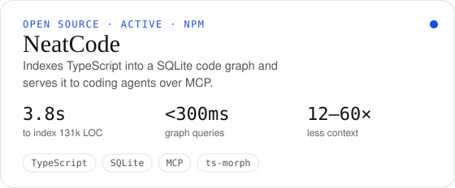
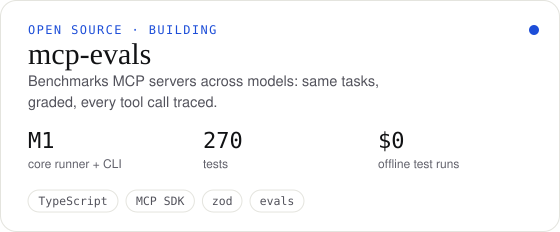

<a href="https://www.shekharkumar.com">
  <picture>
    <source media="(prefers-color-scheme: dark)" srcset="./assets/banner-dark.svg">
    
  </picture>
</a>

<p align="center">
  <a href="https://www.shekharkumar.com"></a>
  <a href="https://www.linkedin.com/in/shekhar-kumar1"></a>
  <a href="mailto:shekharkumar235838@gmail.com"></a>
  <a href="https://www.shekharkumar.com/resume.pdf"></a>
</p>

<p align="center"><b>Senior software engineer in Bengaluru</b> building backend and AI infrastructure: distributed systems, LLM platforms, GPU inference and agent evaluation.<br>Also an independent builder of open-source developer tools. Every project below has a case study with an interactive demo.</p>

## Building in the open

<p>
  <a href="https://github.com/HITMANdark07/neatcodeai">
    <picture>
      <source media="(prefers-color-scheme: dark)" srcset="./assets/card-neatcode-dark.svg">
      
    </picture>
  </a>
  <a href="https://github.com/HITMANdark07/mcp-evals">
    <picture>
      <source media="(prefers-color-scheme: dark)" srcset="./assets/card-mcp-evals-dark.svg">
      
    </picture>
  </a>
</p>

```bash
npm i -g @neatcodeai/cli && neatcode init && neatcode claude install   # give your coding agent a code graph
```

## Recent work

| | Project | What it does | Built with |
|:-:|---|---|---|
| 🎙️ | [**Speech-to-image pipeline**](https://www.shekharkumar.com/projects/gpu-inference) | Live narration → speech-to-text → LLM scene director → images fanned out across ComfyUI GPU pods | FastAPI · Celery · Redis · ComfyUI · AWS GPUs |
| 🧩 | [**Multi-tenant AI app platform**](https://www.shekharkumar.com/projects/ai-apps-platform) | One backend serving several AI apps, tenant-isolated, shipped with blue-green CI/CD | Go · TypeScript · LangGraph · pgvector |
| 💍 | [**Ivorie**](https://www.shekharkumar.com/projects/ivorie) · [live](https://planwithivorie.com/) | Wedding marketplace backend: real-time chat at 10k+ messages a day, milestone payments, Stripe Connect payouts | NestJS · Socket.IO · Redis · PostgreSQL |
| 🤖 | [**Fleet**](https://www.shekharkumar.com/projects/fleet) | Agent evaluation and RL environments that recreate apps like GitHub and Booking.com | TypeScript · RL environments |
| 🧠 | [**Generative AI platform**](https://www.shekharkumar.com/projects/genai-platform) | Model routing, tool calling over MCP, RAG with +25% answer relevance | LangChain · MCP · vector DBs |

## Toolbox

<p align="center">
  
</p>

<p align="center">
  <picture>
    <source media="(prefers-color-scheme: dark)" srcset="https://raw.githubusercontent.com/HITMANdark07/HITMANdark07/output/snake-dark.svg">
    
  </picture>
</p>

<p align="center"><sub>Find the long version at <a href="https://www.shekharkumar.com">shekharkumar.com</a> · press <kbd>⌘</kbd> <kbd>K</kbd> there to jump anywhere.</sub></p>
